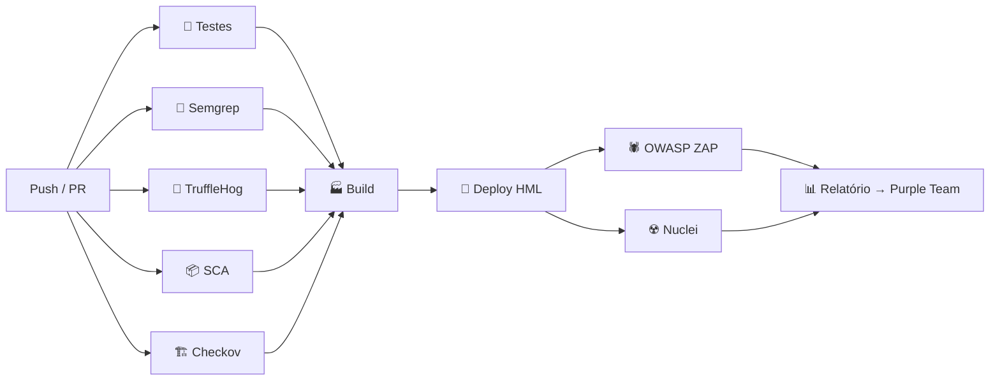

# 🛡️ Projeto Vanguarda — DevSecOps (Tech Challenge · Fase 4)

Repositório de **demonstração** do item *4) Implantação de DevOps e Segurança Integrada (DevSecOps)*.
O Vanguarda é um app mobile que protege pessoas acima de 60 anos contra golpes digitais (links maliciosos, Pix suspeito, phishing por SMS).

> ⚠️ **Simulação:** a API em `services/api` é um protótipo pequeno do "motor de risco", só para as etapas do pipeline terem o que testar e escanear. O deploy na AWS e o build EAS são **simulados** (sem contas pagas). Os scanners de segurança rodam **de verdade**.

## Pipelines (GitHub Actions)

| Workflow | O que faz |
|---|---|
| [`devsecops-pipeline.yml`](.github/workflows/devsecops-pipeline.yml) | Testes unitários + SAST (Semgrep), Secrets (TruffleHog), SCA (npm audit/Dependency Review/SBOM) e IaC (Checkov) **em paralelo** → Build → Deploy HML → DAST (OWASP ZAP) + Red Team (Nuclei) → Relatório |
| [`mobile-eas.yml`](.github/workflows/mobile-eas.yml) | Validação do app Expo → EAS Build (preview/production) → OTA update → EAS Submit com aprovação |
| [`deploy-production.yml`](.github/workflows/deploy-production.yml) | Promoção para produção com aprovação manual (Environment `production`) e rollback |
| [`purple-team-weekly.yml`](.github/workflows/purple-team-weekly.yml) | Varredura profunda semanal que vira pauta da Sprint Retrospective |



## Estrutura

```
.github/            workflows, dependabot, CODEOWNERS, template de PR
services/api/       protótipo NestJS + serverless.yml (IaC com Blue Team: CloudWatch, GuardDuty, throttling)
apps/mobile/        configuração Expo/EAS (app.json, eas.json)
security/           regras Semgrep customizadas, política ZAP, templates Nuclei
.husky/             pre-commit (git-secrets + lint-staged) e commit-msg (commitlint)
```

## Rodando localmente

```bash
npm install                 # instala Husky (hooks de pre-commit)
bash scripts/setup-git-secrets.sh
cd services/api && npm ci && npm test
```

## Autoria e processo

- **Definido pelo grupo (Fases 1 a 3 do Tech Challenge):** visão do produto, MVP, arquitetura (DDD, serverless, microsserviços evolutivos), stack (React Native + Expo, NestJS, AWS Lambda/API Gateway, PostgreSQL + Redis), modelo de implementação (trunk-based, ambientes dev/hml/prd, promoção com aprovação) e as regras de segurança (LGPD, ISO 27001/27002, Security by Design).
- **Implementação acelerada com IA:** seguindo a estratégia registrada na Fase 3 ("Claude Code para lógica complexa, sob supervisão dos devs seniores"), o código e as pipelines foram gerados com **Claude Code a partir das especificações do grupo** e depois **revisados, ajustados e validados pelo time** (testes, scanners e execução real no GitHub Actions).
- Por isso o histórico do repositório mostra o Claude como coautor: é a própria prática de *AI-assisted development* com revisão humana obrigatória que o plano de DevSecOps define (ver template de PR: "código gerado por IA revisado linha a linha").
