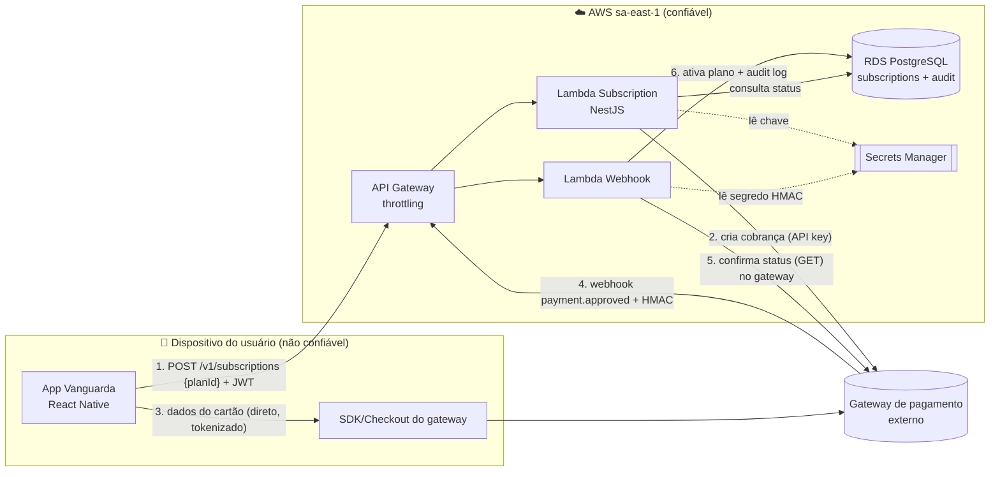

# Threat Model — Assinatura do plano Premium (pagamentos)

| Campo | Valor |
|---|---|
| Versão | 1.0 (antes do início do desenvolvimento) |
| Método | STRIDE + pontuação probabilidade × impacto |
| Participantes | Tech Lead/Platform Engineer, Dev Backend, Dev Mobile, QA, PO |
| Ferramenta | Mermaid (este arquivo) / OWASP Threat Dragon |

## 1. Escopo

**Dentro:** o usuário (ou um familiar) assina o plano Premium no app; o backend cria a cobrança no gateway de pagamento; o gateway confirma via webhook; o backend libera os recursos Premium (por exemplo, alertas para contatos de confiança).

**Fora (neste documento):** compras via App Store/Google Play são tratadas na seção 7 (validação de recibo); antifraude interno do gateway; contabilidade e emissão de nota fiscal.

**Decisão de arquitetura que nasce deste threat model:** o Vanguarda **nunca recebe, trafega nem armazena dados de cartão**. O app usa o SDK/checkout do gateway, que devolve um token. Isso tira o Vanguarda do escopo pesado do PCI-DSS.

## 2. Ativos

| Ativo | Por que importa | Classificação |
|---|---|---|
| Status da assinatura (`plan`, `validUntil`) | Libera funcionalidade paga | Interno / integridade crítica |
| Identidade do pagador (nome, e-mail, CPF parcial) | Dado pessoal (LGPD) | Confidencial |
| Segredo do webhook (HMAC) e chave de API do gateway | Permite forjar pagamentos / cobrar terceiros | Secreto (Secrets Manager) |
| Trilha de auditoria de cobrança | Disputas, chargeback, LGPD | Interno / integridade |
| Reputação do Vanguarda | Público 60+ é alvo de golpes de cobrança falsa | Estratégico |

## 3. Atores

| Ator | Confiável? | Motivação |
|---|---|---|
| Usuário 60+ / familiar pagante | Parcialmente (o dispositivo pode estar comprometido) | Usar o Premium |
| Usuário malicioso | Não | Obter Premium sem pagar, ver dados de outros |
| Golpista externo | Não | Usar a marca Vanguarda para cobranças falsas, roubar dados |
| Gateway de pagamento | Sim, autenticado por assinatura | Confirmar pagamentos |
| Insider / conta de dev comprometida | Não | Alterar planos, exfiltrar dados |

## 4. Diagrama de fluxo de dados

**Fronteiras de confiança:** (A) dispositivo ↔ API Gateway; (B) gateway externo ↔ endpoint de webhook; (C) Lambdas ↔ Secrets Manager/RDS.

## 5. Ameaças (STRIDE)

Pontuação: P (probabilidade) e I (impacto) de 1 a 3; Risco = P × I. **Risco ≥ 6 exige mitigação antes do desenvolvimento.**

| ID | STRIDE | Elemento | Ameaça | P | I | Risco | Mitigação | Verificação automática |
|---|---|---|---|---|---|---|---|---|
| T01 | **S** | Webhook | Atacante envia webhook falso "pagamento aprovado" | 3 | 3 | **9** | Validar assinatura HMAC com comparação em tempo constante; rejeitar timestamp > 5 min; **reconsultar o status no gateway (passo 5)** antes de ativar | Teste unitário de assinatura inválida + template Nuclei `webhook-forged` |
| T02 | **S** | API | Uso de JWT roubado/forjado para assinar em nome de outro | 2 | 3 | **6** | JWT curto (15 min) + refresh rotativo; `jwt.verify` com algoritmo fixo | Regra Semgrep `vanguarda-jwt-decode-without-verify` |
| T03 | **T** | API | Usuário altera preço ou plano na requisição | 3 | 2 | **6** | App envia só `planId`; preço vem do catálogo no servidor; DTO com whitelist | Template Nuclei `vanguarda-mass-assignment` |
| T04 | **T** | Webhook | Replay de um webhook legítimo para estender a assinatura | 2 | 2 | 4 | Idempotência por `event_id` (UNIQUE no banco) + janela de timestamp | Teste de integração com evento duplicado |
| T05 | **R** | Banco | Usuário nega ter assinado (disputa/chargeback) | 2 | 2 | 4 | Trilha de auditoria imutável (append-only): quem, quando, IP, versão do app, ID da transação | Revisão no Code Review (CODEOWNER) |
| T06 | **I** | App/API | Vazamento de dados de cartão | 1 | 3 | 3 | **Tokenização no gateway**: o cartão nunca toca o Vanguarda | Regra Semgrep `vanguarda-pii-in-logs` + TruffleHog |
| T07 | **I** | Logs | CPF/e-mail do pagador em logs | 2 | 2 | 4 | Logger de segurança com allowlist de campos | Regra Semgrep `vanguarda-pii-in-logs` |
| T08 | **I** | Segredos | Chave do gateway ou segredo HMAC vazados no repositório | 2 | 3 | **6** | Secrets Manager + IAM de menor privilégio; padrões `sk_live_` no git-secrets | git-secrets (pre-commit) + TruffleHog (CI) |
| T09 | **D** | API | Flood no checkout gerando custo e cobranças lixo no gateway | 2 | 2 | 4 | Rate limit dedicado (5/min por usuário) + throttling no API Gateway + idempotency key | Teste de abuso (HTTP 429) no job Red Team |
| T10 | **E** | API | IDOR: consultar/alterar assinatura de outro `userId` | 3 | 3 | **9** | `userId` vem **só do token**, nunca do path/body; teste de autorização por recurso | Teste e2e de autorização + ZAP |
| T11 | **E** | App | App modificado libera recursos Premium localmente | 3 | 1 | 3 | Recursos Premium decididos no servidor (o app só exibe) | Revisão de arquitetura |
| T12 | **S** | Usuário | Golpistas enviam SMS de "cobrança do Vanguarda" com link falso | 3 | 3 | **9** | Nunca cobrar por SMS/WhatsApp; comunicação só dentro do app; o próprio motor de risco marca domínios que imitam o Vanguarda | Heurística `URL_BRAND_IMPERSONATION` incluindo a marca Vanguarda |
| T13 | **E** | Pipeline | Conta de dev comprometida altera a lógica de ativação | 1 | 3 | 3 | Branch protection + CODEOWNERS + 2 aprovações para código de pagamento + deploy de PRD com aprovação | Configuração do GitHub (prints na documentação) |

## 6. Backlog gerado (critérios de aceite)

- [ ] **Webhook:** rejeitar requisições sem assinatura válida (HTTP 401) e com timestamp fora da janela; registrar `SECURITY_EVENT` `WEBHOOK_REJECTED`.
- [ ] **Webhook:** ativar o plano somente após `GET` de confirmação no gateway retornar `approved`.
- [ ] **Idempotência:** tabela `payment_events(event_id UNIQUE)`; o segundo processamento do mesmo evento não altera nada.
- [ ] **Catálogo:** preço e duração resolvidos no servidor a partir de `planId`; teste que envia `price` no body deve receber 400.
- [ ] **Autorização:** todas as rotas `/v1/subscriptions/*` usam o `userId` do token; teste com token do usuário A tentando ler B deve receber 404.
- [ ] **Auditoria:** registro append-only de cada mudança de plano.
- [ ] **Rate limit:** 5 tentativas de checkout por minuto por usuário.
- [ ] **Alarme:** Metric Filter `WEBHOOK_REJECTED` > 10 em 5 min → SNS (possível ataque).
- [ ] **Comunicação:** texto no app avisando que o Vanguarda nunca cobra por SMS ou WhatsApp.

## 7. Compras pelas lojas (App Store / Google Play)

Se a assinatura for feita pela loja: o **recibo é validado no servidor** (App Store Server API / Google Play Developer API), nunca confiando no app; as notificações da loja (App Store Server Notifications / Real-time Developer Notifications) seguem as mesmas regras de T01, T04 e T10.

## 8. Riscos residuais aceitos

| Risco | Justificativa | Dono | Revisar em |
|---|---|---|---|
| Fraude de cartão no gateway | Responsabilidade contratual do gateway (antifraude dele) | PO | Contrato com o gateway |
| Golpe fora do app usando a marca (T12) | Mitigado parcialmente; depende de educação do usuário | PO + Tech Lead | Toda retrospectiva de Purple Team |
